  

 

Construyo productos completos, de la base de datos al bolsillo del usuario: APIs en **.NET** y **NestJS**, webs en **Angular**, apps en **React Native**, y la infraestructura que los mantiene en pie. Me obsesiona que el software funcione **sin conexión**, que la IA **ayude de verdad** y que un despliegue sea un no-evento.

## 🚀 Lo que estoy construyendo

<table>
  <tr>
    <td width="50%" valign="top">
      <h3>🧾 Fappture</h3>
      
Plataforma de gestión para negocios: punto de venta, restaurante con cocina en tiempo real, hotel, inventario, finanzas y nómina, con <b>Sofía</b>, una asistente de IA que consulta y opera el negocio.

      

        
        
        
        
        
      

    </td>
    <td width="50%" valign="top">
      <h3>🛰️ Network</h3>
      
Plataforma SaaS con backend .NET, panel web, app móvil y conectores, más simuladores propios (ISP, banca, WhatsApp) para probar cada integración sin tocar producción.

      

        
        
        
        
      

    </td>
  </tr>
</table>

## 🧩 Open source

| | Proyecto | Qué hace |
|---|---|---|
| 🐸 | [**cnnp**](https://github.com/P0ND4/cnnp) | CLI que genera un proyecto NestJS listo para producción, con arquitectura y dependencias ya instaladas. |
| 🤖 | [**ms-ia-service**](https://github.com/P0ND4/ms-ia-service) | Orquestador de agentes de IA: ejecución sync/stream, fallback de proveedores, guardrails y métricas por tenant. |
| 🪪 | [**ms-identity-service**](https://github.com/P0ND4/ms-identity-service) | Identidad y acceso con JWT/OAuth, RBAC, PostgreSQL y Redis. |
| ✉️ | [**ms-mailer-service**](https://github.com/P0ND4/ms-mailer-service) | Email, SMS, WhatsApp y voz con colas BullMQ, Redis y OTP configurable. |
| ⚙️ | [**ms-config-service**](https://github.com/P0ND4/ms-config-service) | Configuración centralizada con auditoría, rollback y sincronización en tiempo real. |
| ♟️ | [**heavy-thinking**](https://github.com/P0ND4/heavy-thinking) | Motor de ajedrez multi-agente con IA y redes neuronales (experimental). |

## 🛠️ Con qué trabajo

   
  

## 📈 Últimos 12 meses

<picture>
  <source media="(prefers-color-scheme: dark)" srcset="https://raw.githubusercontent.com/P0ND4/P0ND4/output/snake-dark.svg">
  <source media="(prefers-color-scheme: light)" srcset="https://raw.githubusercontent.com/P0ND4/P0ND4/output/snake-light.svg">
  
</picture>

---

> *El código no es solo una secuencia de instrucciones para la máquina: es el puente donde la lógica humana se vuelve arte tangible. Y depurar es el acto de humildad de aceptar que la perfección no está en el primer intento, sino en la iteración constante.*

8+ años construyendo software · 35+ proyectos · Caracas, Venezuela 🇻🇪

